# PAR GPT Architecture Documentation

This document provides a comprehensive overview of PAR GPT's architecture, design patterns, and module organization.

## Table of Contents

1. [Overview](#overview)
2. [High-Level Architecture](#high-level-architecture)
3. [Module Organization](#module-organization)
4. [Design Patterns](#design-patterns)
5. [Data Flow](#data-flow)
6. [Security Architecture](#security-architecture)
7. [Performance Optimizations](#performance-optimizations)
8. [Extension Points](#extension-points)

## Overview

PAR GPT is a sophisticated command-line AI interface built with Python 3.12 or higher (3.13 recommended). The architecture follows modern software engineering principles including modularity, separation of concerns, lazy loading, and comprehensive security measures. The application is built around the **PAR Utils** package - a fully-integrated reusable utilities framework that provides core functionalities like performance monitoring, security validation, error handling, and caching systems.

### Key Architectural Principles

- **Modular Design**: Clear separation between CLI, commands, core logic, and external services
- **Security First**: Comprehensive path validation, code execution safety, and user confirmation systems
- **Performance Optimized**: Lazy loading system reducing startup time by 25-50%
- **Thread Safety**: Thread-safe context management for concurrent operations
- **Extensibility**: Plugin-style tool loading and command pattern for easy extension

## High-Level Architecture

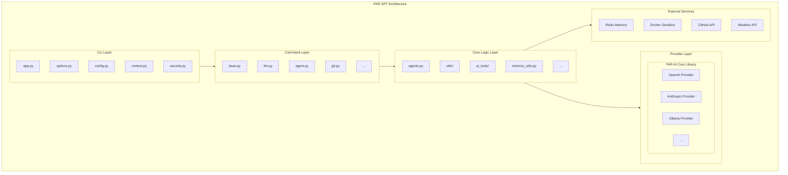

## Module Organization

### Core Structure

```
src/par_gpt/
├── __main__.py                 # Entry point: Typer app + command registration
├── cli/                        # CLI Infrastructure Layer
│   ├── app.py                 # Main Typer app, state construction, option wiring
│   ├── options.py             # CLI option definitions
│   ├── config.py              # Configuration setup and global initialization
│   ├── context.py             # Context processing (files, URLs, stdin, images)
│   └── security.py            # Security validation and mutual-exclusivity checks
├── commands/                   # Command Pattern Implementation
│   ├── base.py                # BaseCommand + LLMCommandMixin / LoopableCommandMixin / ChatHistoryMixin
│   ├── llm.py                 # LLM command
│   ├── agent.py               # Agent command
│   ├── git.py                 # Git operations
│   └── ...                    # code-review, sandbox, stardew, generate-prompt, etc.
├── ai_tools/                  # AI Tools (Plugin System)
│   ├── ai_tools.py            # Tool implementations (each small, @tool(parse_docstring=True))
│   └── par_python_repl.py     # Host & sandboxed REPL tools
├── utils/                     # Domain submodule package (post-ARC-001; the utils.py monolith is deleted)
│   ├── __init__.py            # Re-exports the public surface from submodules + par_utils
│   ├── _singletons.py         # Process-wide shared singletons (cache_manager), constructed exactly once
│   ├── utils_facade.py        # Backward-compat facade bridging ai_tools -> utils / par_utils
│   ├── weather.py             # Weather lookup
│   ├── figlet_utils.py        # ASCII art (figlet)
│   ├── terminal_image.py      # Terminal image rendering (sixel / pixel blocks)
│   ├── env_context.py         # Environment / system context gathering
│   ├── screen_capture.py      # macOS window / screen enumeration and capture
│   ├── image_description.py   # LLM-based image description
│   ├── media_generation.py    # DALL-E image generation, TTS (speak)
│   ├── pyproject_deps.py      # pyproject dependency updating
│   ├── github_utils.py        # GitHub repo publishing
│   ├── redis_client.py        # Redis client construction
│   ├── audio_manager.py       # Audio playback and cleanup
│   ├── image_processor.py     # Image preprocessing
│   ├── redis_manager.py       # Redis-backed memory management
│   ├── config.py              # EnvironmentConfig model
│   ├── config_validation.py   # Pydantic-based configuration validation
│   ├── context_manager.py     # ThreadSafeContextManager (locked, per-thread contexts)
│   ├── llm_invoker.py         # Single LLM call helper
│   ├── path_security.py       # Path-security helpers (re-exports par_utils validators)
│   ├── security_warnings.py   # Security warning panels
│   └── error_helpers.py       # Backward-compat re-export of par_utils error handlers
├── memory_utils.py            # Redis-based persistent memory utilities
├── agents.py                  # Agent orchestration (tool agent, single LLM call)
├── lazy_import_manager.py     # PARGPTLazyImportManager (PAR GPT-specific loaders)
└── tool_context.py            # Global tool context (thread-safe backend)

src/par_utils/                  # PAR Utils Package
├── __init__.py                # Main exports
├── py.typed                   # Type declarations
├── performance/               # Performance Utilities
│   ├── timing.py              # Performance measurement
│   └── lazy_loading.py        # LazyImportManager (lazy import management)
├── security/                  # Security Utilities
│   └── path_validation.py     # Path security validation
├── errors/                    # Error Management (ErrorMessage / ErrorRegistry live here)
│   ├── registry.py            # Error message registry (ErrorMessage, register_error, ...)
│   └── handlers.py            # Error handling utilities (ErrorHandler)
├── caching/                   # Caching System
│   └── disk_cache.py          # Thread-safe disk cache
└── console/                   # Console Management
    └── manager.py             # Rich console utilities
```

> Note: line counts are intentionally omitted — they rot quickly. See `wc -l` for current sizes.

### Layer Responsibilities

#### CLI Layer (`cli/`)
- **Command Line Interface**: Typer app setup and argument parsing
- **Configuration Management**: Environment loading and validation
- **Context Processing**: File, URL, and image handling
- **Security Validation**: Mutual exclusivity checks and warnings

#### Command Layer (`commands/`)
- **Command Pattern**: Consistent command structure with mixins
- **Business Logic**: Implementation of specific commands
- **State Management**: Context passing and result handling
- **Error Handling**: Consistent error processing

#### Core Logic Layer
- **Agent Orchestration**: AI tool coordination and execution
- **Memory Management**: Redis-based persistent memory
- **Utility Functions**: Shared functionality across modules
- **Security Framework**: Path validation and execution safety

#### PAR Utils Package
- **Performance Optimization**: Timing measurement and lazy loading
- **Security Validation**: Path traversal protection and filename sanitization
- **Error Management**: Centralized error registry with structured messaging
- **Caching System**: Thread-safe disk caching with URL downloads
- **Console Management**: Rich-based terminal output management

## Design Patterns

### 1. Command Pattern

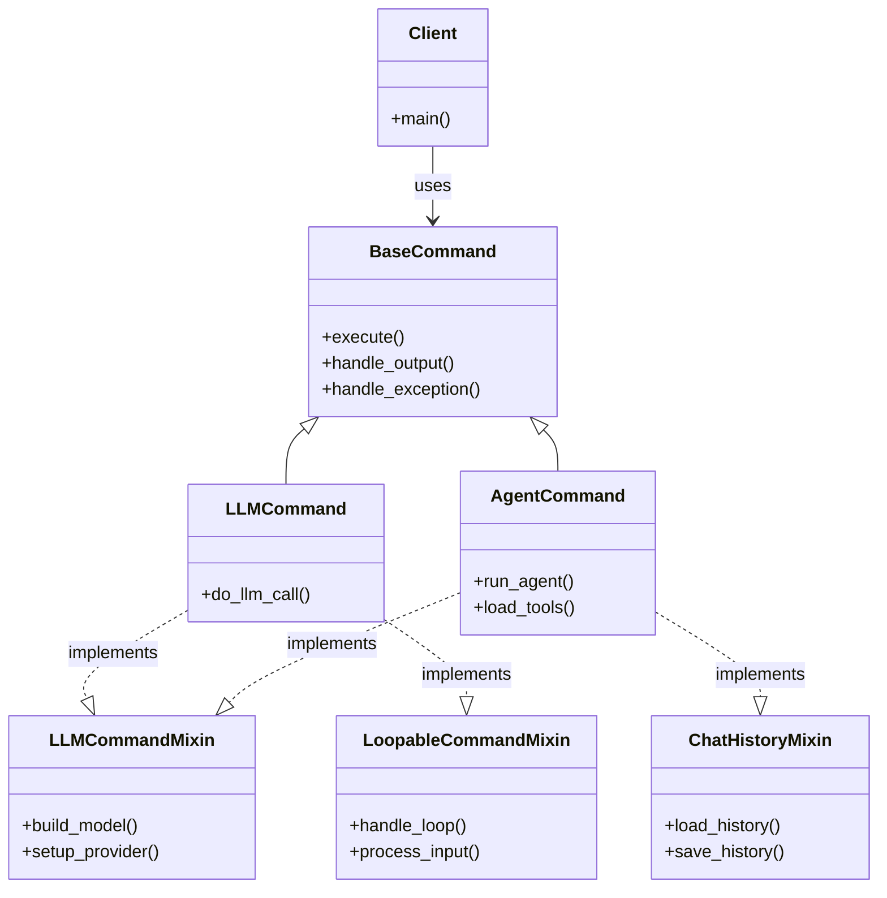

### 2. Strategy Pattern (Providers)

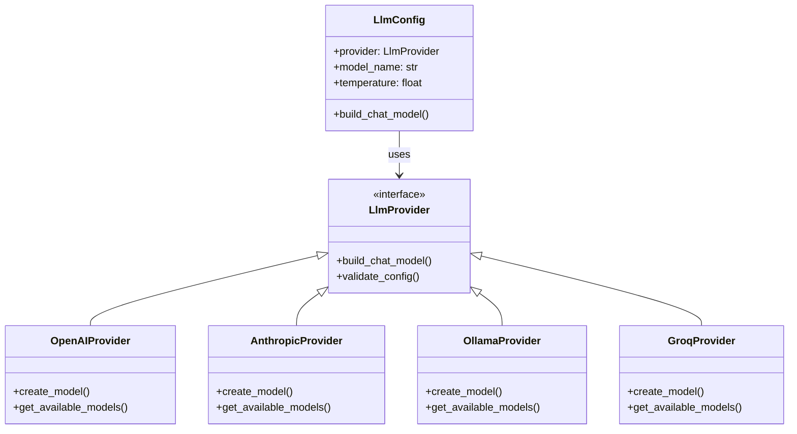

### 3. Facade Pattern (Utils Import)

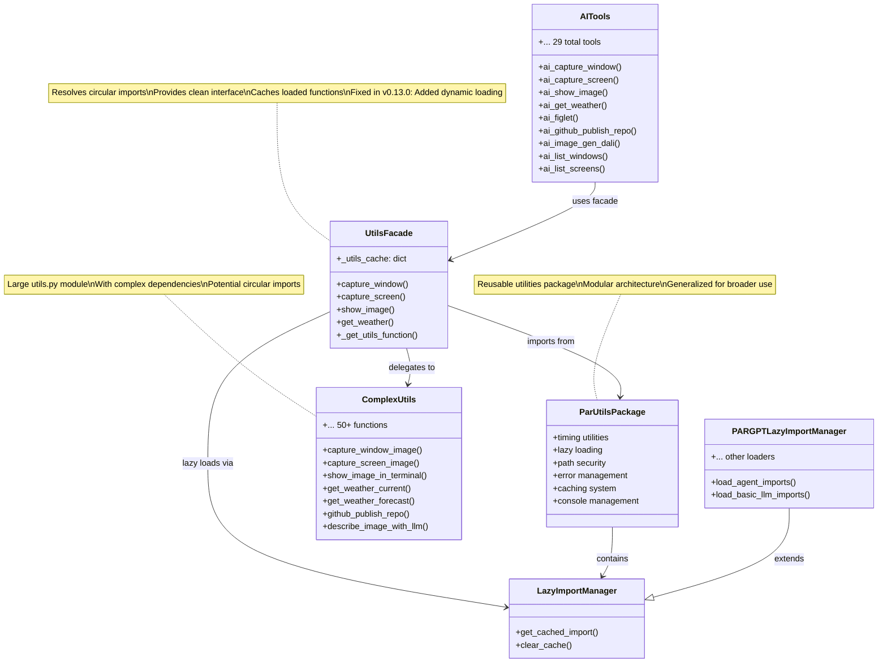

### 4. Singleton Pattern (Registries)

The process-wide registries use a `__new__`-based singleton so a single instance is
shared across threads:

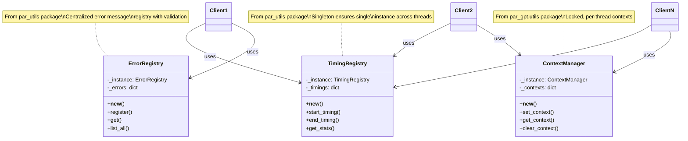

> `LazyImportManager` is intentionally **not** shown here. It is currently *not* a
> singleton: each module constructs its own instance with a private `_import_cache`
> (20+ `LazyImportManager()` constructions across the codebase), and `get_cached_import`
> holds no lock, so the cache is not coordinated across modules or safe under
> concurrent first-access. Consolidating to a single process-wide, thread-safe manager
> is tracked as **ARC-003** (Phase 3b, in progress); see *Lazy Loading Architecture*
> below.

### 5. Provider Dependency Boundary (`par_ai_core` / `par_utils`)

PAR GPT does not implement model providers itself. It depends on the `par_ai_core` library for
provider selection, configuration, and model construction, and on the bundled `par_utils` package
for cross-cutting utilities. The diagram below shows that boundary: `par_gpt` wires an
`LlmConfig` and invokes the model; `par_ai_core` owns the provider implementations and the
`build_chat_model()` step; concrete provider SDKs are pulled in by `par_ai_core`, not by
`par_gpt` directly.

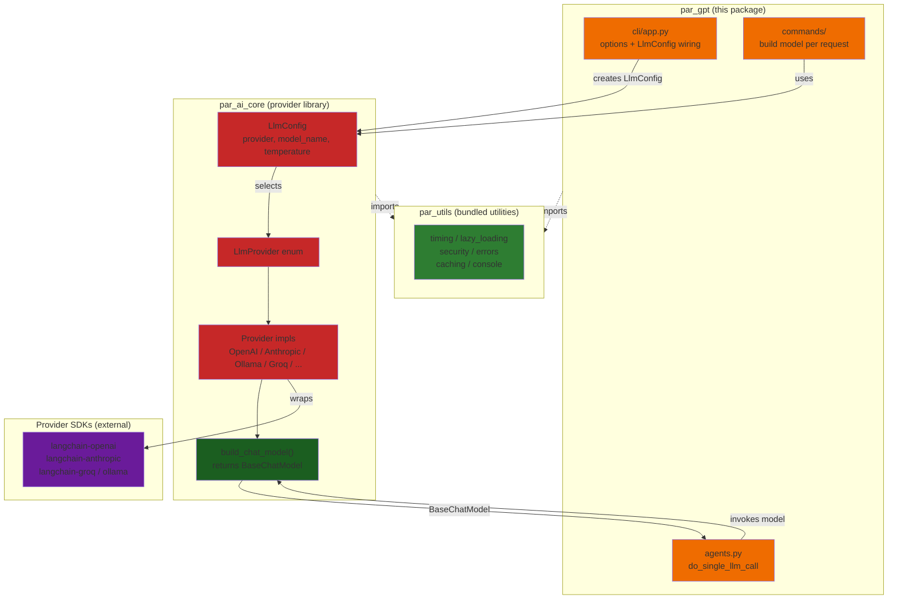

Key points:

- `par_gpt` never imports a provider SDK directly; it goes through `LlmConfig.build_chat_model()`.
- Provider routing (`LlmProvider` enum, base URLs, reasoning-model detection) is owned by `par_ai_core`.
- `par_utils` is a dependency of both packages and supplies timing, lazy loading, path security, error handling, caching, and console management.

## Data Flow

### 1. Basic LLM Mode Flow

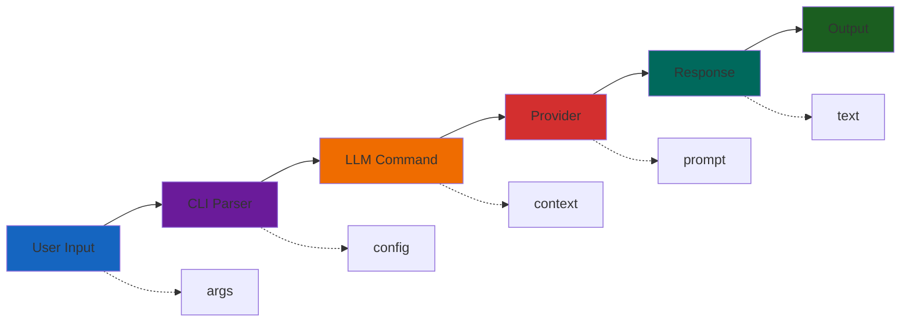

### 2. Agent Mode Flow

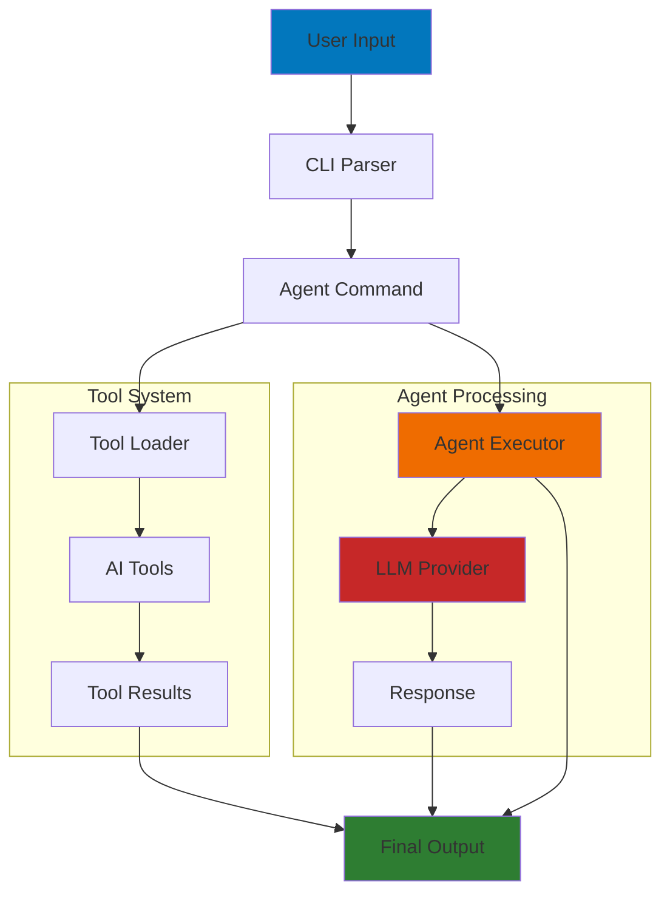

### 3. Security Validation Flow

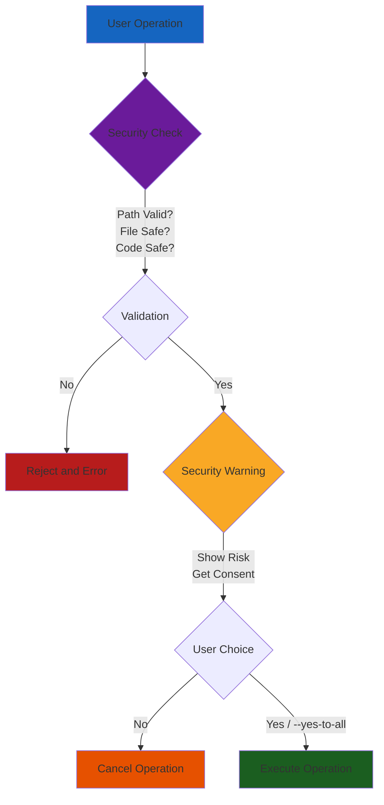

## Security Architecture

### 1. Multi-Layer Security

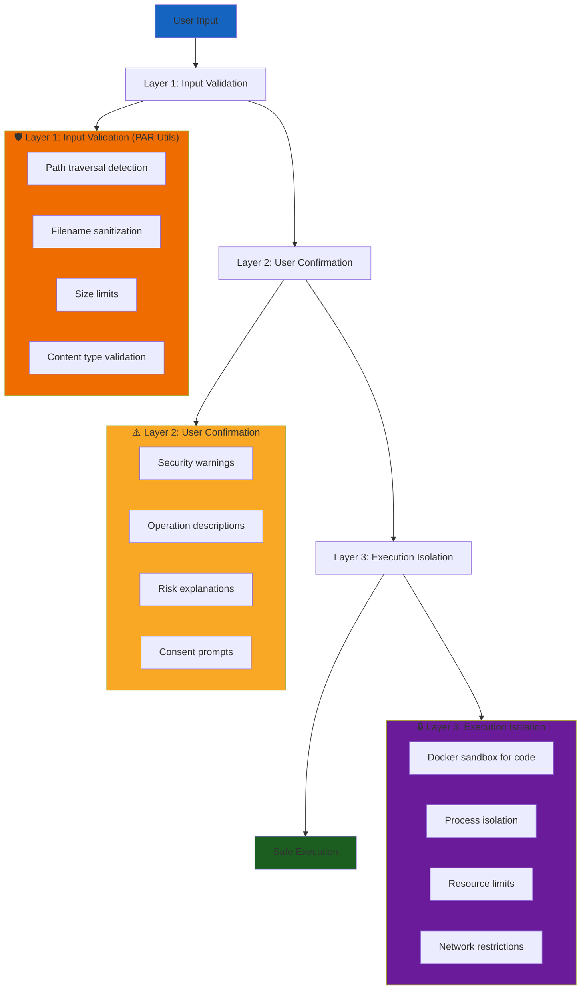

### 2. Path Security Implementation (PAR Utils)

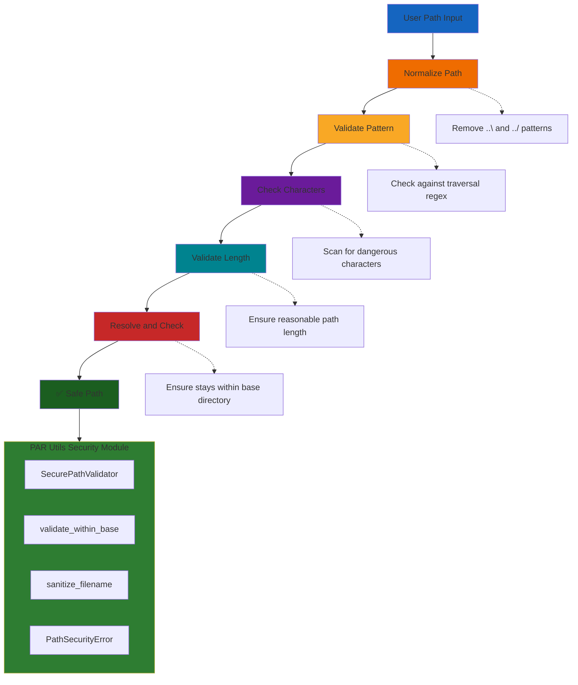

## Performance Optimizations

### 1. Lazy Loading System (PAR Utils)

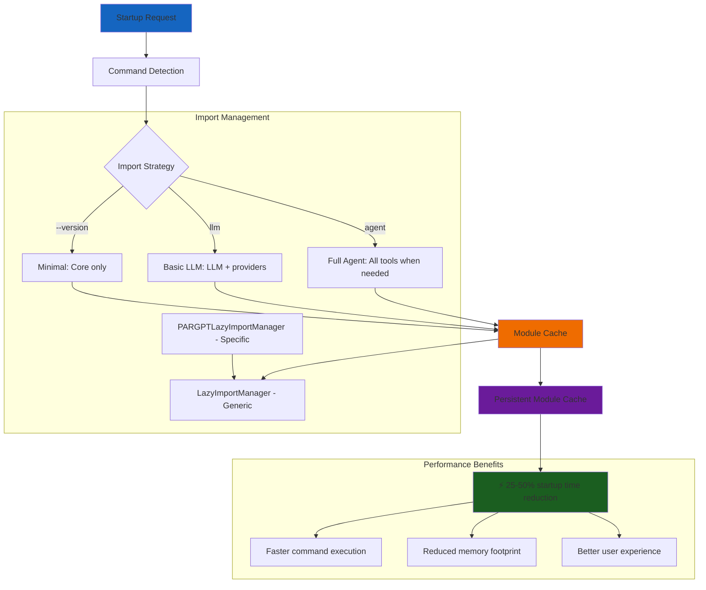

### 2. Command Classification

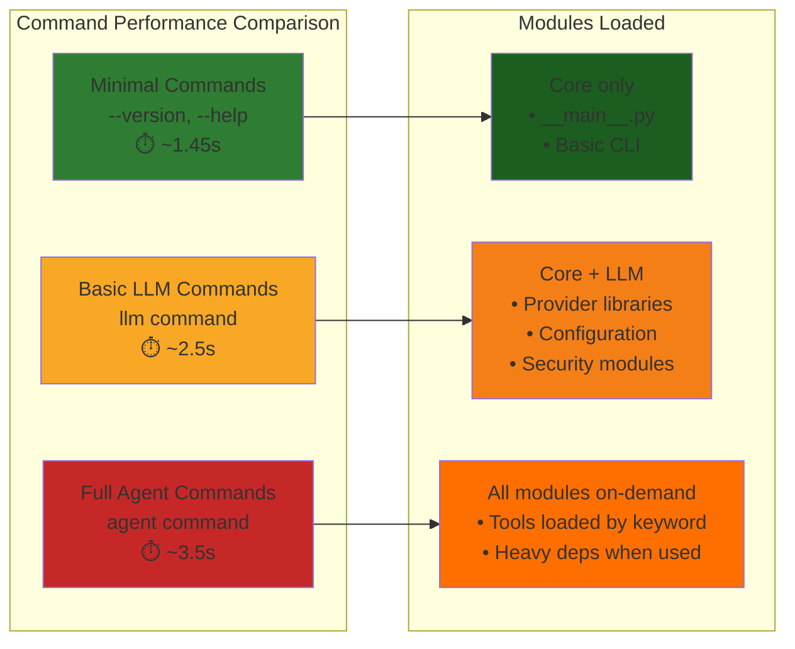

### 3. Advanced Timing System (PAR Utils)

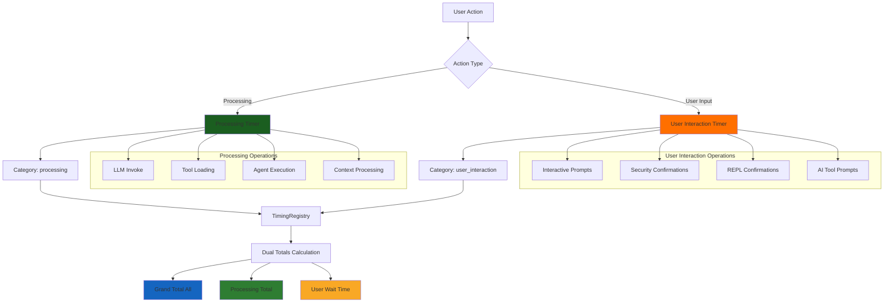

**Key Benefits:**
- **Accurate Performance Metrics**: Pure processing time without user delay skew
- **User Experience Analytics**: Track actual user response times
- **Bottleneck Identification**: Distinguish processing vs user interaction delays
- **Automation Planning**: Estimate true processing time for automated workflows

## Lazy Loading Architecture

PAR GPT uses a two-layer lazy loading system:

### Generic Layer (PAR Utils)
The base `LazyImportManager` from PAR Utils provides:
- Module and item-specific lazy loading (per-instance `_import_cache`)
- Cache management and statistics

> Current-state caveat: `LazyImportManager` is **not** a process-wide singleton and
> `get_cached_import` holds **no lock**. Each module constructs its own instance
> (20+ `LazyImportManager()` constructions across the codebase, plus 16 copy-pasted
> local `def lazy_import(...)` wrappers), so caches are not shared across modules and
> the claim of "thread-safe import caching" does not hold today. Consolidating to a
> single shared, thread-safe manager is tracked as **ARC-003** (Phase 3b, in progress);
> this section will be refreshed once that refactor lands.

### Application Layer (PAR GPT)
The `PARGPTLazyImportManager` extends the base class with:
- Command-specific import loading (`load_agent_imports`, `load_basic_llm_imports`, etc.)
- Integration with PAR GPT's command structure
- Provider and tool-specific loading strategies

### Usage Pattern

```python
# For PAR GPT-specific functionality
from par_gpt.lazy_import_manager import PARGPTLazyImportManager

manager = PARGPTLazyImportManager()
agent_imports = manager.load_agent_imports()

# For generic lazy loading (e.g., in AI tools)
from par_utils import LazyImportManager

generic_manager = LazyImportManager()
module = generic_manager.get_cached_import("some_module")
```

## Extension Points

### 1. Adding New Commands

```python
# 1. Create command class
class MyCommand(BaseCommand, LLMCommandMixin):
    def execute(self, ctx: typer.Context, my_option: bool) -> None:
        state = ctx.obj
        # Implementation here

# 2. Create factory function
def create_my_command():
    def my_command(ctx: typer.Context, my_option: bool = False) -> None:
        command = MyCommand()
        command.execute(ctx, my_option)
    return my_command

# 3. Register in __main__.py
app.command()(create_my_command())
```

### 2. Adding New AI Tools

```python
# 1. Create tool function
@tool(parse_docstring=True)
def my_new_tool(param: str) -> str:
    """Tool description.
    
    Args:
        param: Parameter description.
        
    Returns:
        Result description.
    """
    return "Tool result"

# 2. Register the tool in lazy_tool_loader.py
# Tools are added inside LazyToolLoader.get_conditional_tools(), where selection is
# gated on the question text (current behavior tracked under ARC-006). The public
# entry point is build_ai_tool_list:
def build_ai_tool_list(
    question: str,
    *,
    repl: bool = False,
    code_sandbox: bool = False,
    yes_to_all: bool = False,
    enable_redis: bool = False,
) -> tuple[list[BaseTool], dict[str, Any]]:
    ...
    # Returns (all_tools, local_modules); local_modules holds any REPL namespaces
    # the caller is responsible for cleaning up.
```

### 3. Adding New Providers

```python
# In par_ai_core library:
class MyProvider(BaseLlmProvider):
    def build_chat_model(self) -> BaseChatModel:
        # Implementation
        pass

# Register provider in par_ai_core
LlmProvider.MY_PROVIDER = "MyProvider"
```

### 4. Custom Error Messages

```python
from par_utils.errors.registry import ErrorMessage, ErrorCategory, ErrorSeverity, register_error

# Register new error
register_error(ErrorMessage(
    code="MY_CUSTOM_ERROR",
    message="Custom error: {details}",
    category=ErrorCategory.CUSTOM,
    severity=ErrorSeverity.ERROR,
    solution="Fix the custom issue",
))

# Use in code
from par_gpt.utils.error_helpers import ErrorHandler
handler = ErrorHandler(console)
handler.show_error("MY_CUSTOM_ERROR", details="specific issue")
```

## Threading and Concurrency

### Thread-Safe Context Management

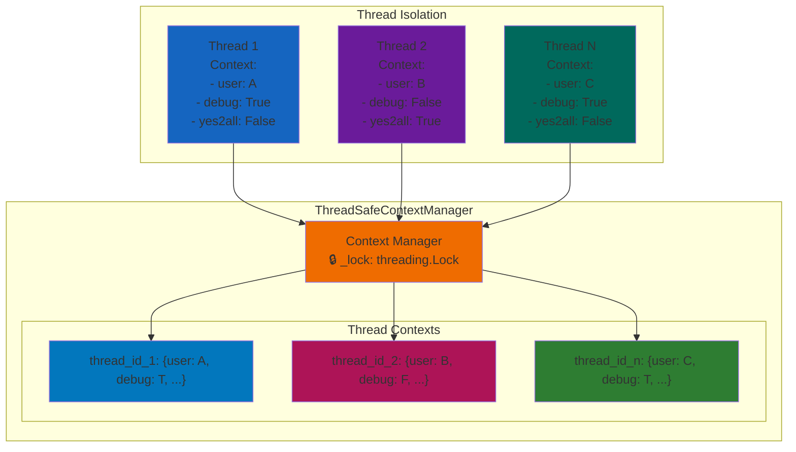

## Conclusion

This architecture provides a solid foundation for a secure, performant, and extensible AI CLI tool. The modular design allows for easy maintenance and extension, while the comprehensive security measures ensure safe operation even with potentially dangerous AI-generated code execution.

Key architectural strengths:
- **Clean separation of concerns** between layers and packages
- **Comprehensive security** with multiple validation layers powered by PAR Utils
- **High performance** through lazy loading optimization from PAR Utils
- **Easy extensibility** via plugin patterns and modular utilities
- **Thread safety** for concurrent operations using PAR Utils registries
- **Consistent error handling** with centralized registry in PAR Utils
- **Reusable utilities** via the generalized PAR Utils package
- **Backward compatibility** maintained through facade patterns

The architecture has evolved through multiple iterations to address technical debt while maintaining backward compatibility and enhancing security and performance. The extraction of PAR Utils creates a reusable foundation that can benefit other projects while keeping PAR GPT's core functionality intact.